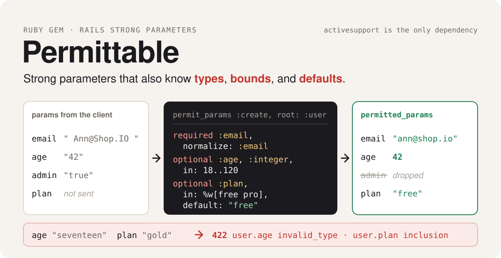
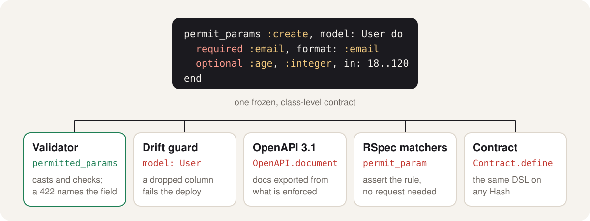

<p align="center">
  
</p>

<p align="center">
  <a href="https://rubygems.org/gems/permittable"></a>
  <a href="https://github.com/VSN2015/permittable/actions/workflows/ci.yml"></a>
  <a href="https://www.ruby-lang.org/"></a>
  <a href="https://rubyonrails.org/"></a>
  <a href="LICENSE.txt"></a>
</p>

<p align="center">
  <a href="#quick-start">Quick start</a> ·
  <a href="#why">Why</a> ·
  <a href="#adopting-on-a-live-api">Adopting on a live API</a> ·
  <a href="docs/guide.md">Guide</a> ·
  <a href="docs/guide.md#reference">Reference</a> ·
  <a href="docs/comparison.md">Comparison</a> ·
  <a href="CHANGELOG.md">Changelog</a>
</p>

---

`params.permit` answers one question: *which keys may pass?* A Permittable **contract**, declared once on the controller class, also **casts** each field to a declared type, **validates** it, applies **defaults**, and turns every failure into a machine-readable 422 that names the offending parameter.

```ruby
class UsersController < ApplicationController
  include Permittable

  permit_params :create, :update, root: :user, model: User do
    required :name,  :string,  length: 1..80, normalize: :squish
    required :email, :string,  format: URI::MailTo::EMAIL_REGEXP, normalize: :email
    optional :age,   :integer, in: 18..120
    optional :ssn,   :string,  sensitive: true          # auto-redacted from logs
    optional :plan,  :string,  in: %w[free pro], default: "free"
    array    :tag_names, of: :string, length: 0..10, virtual: true
    optional :address do
      required :city, :string
      optional :zip,  :string, format: /\A\d{5}\z/
    end
  end

  def create
    User.create!(permitted_params)   # cast, validated, defaulted
  end
end
```

A violating request never reaches your action:

```json
{ "success": false,
  "error": { "message": "Invalid parameters: user.age (inclusion)",
             "code": "invalid_parameters",
             "details": [{ "param": "user.age", "code": "inclusion" }] } }
```

## Quick start

```ruby
# Gemfile
gem "permittable"
```

```ruby
class ApplicationController < ActionController::Base
  include Permittable
end

class OrdersController < ApplicationController
  permit_params :create, root: :order, model: Order do
    required :sku,      :string
    optional :quantity, :integer, in: 1..99, default: 1
    optional :notes,    :string,  length: 0..500
  end

  def create
    Order.create!(permitted_params)
  end
end
```

That is the whole integration. Violations render the 422 automatically, `model: Order` checks the fields against the `orders` table when the class loads, and every rejected request emits an `invalid_parameters.permittable` notification.

> **Naming note:** some legacy stacks (InheritedResources) define their own `permitted_params`. Don't include both on one controller.

## Why

Here is what the contract above replaces. Every Rails codebase has a version of this, and no two of them agree on the error shape:

```ruby
def create
  attrs = params.require(:user).permit(:name, :email, :age, :plan)

  if attrs[:age].present?
    age = Integer(attrs[:age], exception: false)
    return render(json: { error: "age must be a number" }, status: 422) if age.nil?
    return render(json: { error: "age must be 18..120" },  status: 422) unless (18..120).cover?(age)
    attrs[:age] = age
  end
  unless attrs[:email].to_s.match?(URI::MailTo::EMAIL_REGEXP)
    return render(json: { error: "email is invalid" }, status: 422)
  end
  attrs[:plan] = "free" if attrs[:plan].blank?

  User.create!(attrs)
end
```

| | `params.permit` | `params.expect` (Rails 8) | Permittable |
|---|:---:|:---:|:---:|
| Filters unknown keys | ✅ | ✅ | ✅ |
| Requires a root key | via `require` | ✅ | ✅ |
| Casts to a declared type | ❌ | ❌ | ✅ |
| Validates bounds, formats, sets | ❌ | ❌ | ✅ |
| Supplies defaults | ❌ | ❌ | ✅ |
| Machine-readable error details | ❌ | ❌ | ✅ |
| Reshapes output | ❌ | ❌ | ✅ |
| Checked against your schema at boot | ❌ | ❌ | ✅ |
| Exports OpenAPI / JSON Schema | ❌ | ❌ | ✅ |
| Report-only rollout mode | ❌ | ❌ | ✅ |
| Drafts contracts from your schema | ❌ | ❌ | ✅ |
| Works outside controllers | ❌ | ❌ | ✅ |

Every option in this space is good software, and Permittable is not always the right one. The [comparison](docs/comparison.md) covers `params.expect`, rails_param, dry-validation, typed_params and rswag, the cases where each is the better choice, benchmarks, and migration costs.

## How it works: a contract is data

A contract is **declared once at the class level, frozen, inheritable, and introspectable**. It is not code that runs inside your action, so more than the validator can read it:

<p align="center">
  
</p>

The principles that fall out of it:

- **Strict, never lenient.** `"abc"` is never `0`. A value the type cannot faithfully represent is a violation, not a guess.
- **`nil` and `""` are absent.** Absent optionals are omitted from the result, so partial updates never nil-out columns.
- **Mistakes fail at class load.** A malformed contract, a default that violates its own field, or a column that no longer exists fails the boot, never the request.
- **The request's `params` is never mutated.** Reshaping happens on the validated copy.
- **Exports never guess.** Anything JSON Schema cannot represent stays visible as an `x-permittable-*` extension instead of being mistranslated.
- **One dependency.** `activesupport` is the only runtime requirement. Rails, ActionPack, and ActiveRecord are optional integration points.

## Adopting on a live API

You cannot know what the 422s would break until you enforce them, and you dare not enforce them until you know. Old app versions, third-party integrations and forgotten cron jobs all send what they send. The recipe:

1. **Draft.** `bin/rails permittable:generate` writes a first contract for every controller from the model's columns and the `params.permit` / `params.expect` calls already in the source.
2. **Monitor.** Deploy with `PERMITTABLE_MODE=monitor`. Behaviour is unchanged; every would-be rejection is logged and instrumented.
3. **Watch.** Point your notification subscriber at a dashboard. Each entry is a real client that would have been rejected: fix the contract, or wait for that traffic to drain.
4. **Enforce.** Flip to enforce, controller by controller. Every 422 you now return is one you already counted.

Then keep it that way: `bin/rails "permittable:audit[strict]"` crosses your contracts with the route set and exits 1 on any write action that accepts a body without a contract, which makes it a CI gate.

```
orders
  POST   /orders                            create       enforce
  PUT    /orders/{id}                       update       no contract — ACCEPTS A BODY
```

Details: [monitor mode](docs/guide.md#monitor-mode-roll-out-without-rejecting) · [generating drafts](docs/guide.md#generating-draft-contracts-permittablegenerate) · [auditing coverage](docs/guide.md#auditing-coverage-permittableaudit).

## Documentation

The [guide](docs/guide.md) is the full manual.

- **[Complete example](docs/guide.md#complete-example):** every option at once, in one events API
- **[Declaring contracts](docs/guide.md#guide):** [field DSL](docs/guide.md#the-field-dsl) · [field options](docs/guide.md#field-options) · [types and strict coercion](docs/guide.md#types-and-strict-coercion) · [defaults and partial updates](docs/guide.md#absence-defaults-and-partial-updates) · [reusing fields](docs/guide.md#reusing-fields-permittablefields-and-use) · [output reshaping](docs/guide.md#output-reshaping-transform-and-finalize)
- **[Errors](docs/guide.md#violations-and-error-responses):** [custom messages and I18n](docs/guide.md#custom-error-messages-message) · [RFC 9457 problem+json](docs/guide.md#rfc-9457-problemjson) · [unknown parameters](docs/guide.md#unknown-parameters)
- **Safety:** [schema-drift guard](docs/guide.md#the-schema-drift-guard) · [log redaction](docs/guide.md#sensitive-parameters-and-log-redaction) · [instrumentation](docs/guide.md#instrumentation)
- **[Beyond the controller](docs/guide.md#beyond-the-controller):** [RSpec matchers](docs/guide.md#testing-contracts-rspec-matchers) · [standalone contracts](docs/guide.md#standalone-contracts-no-controller) · [OpenAPI export](docs/guide.md#exporting-openapi-docs-that-cannot-drift)
- **[Reference](docs/guide.md#reference):** [API](docs/guide.md#api) · [errors caught at class load](docs/guide.md#errors-caught-at-class-load)

## Compatibility

| Requirement | Supported |
|---|---|
| Ruby | >= 3.2 |
| Rails / ActiveSupport | >= 6.1, < 9 |
| Required dependency | `activesupport` only |
| Optional | `actionpack` (rendering, `before_action`), `activerecord` (drift guard) |

CI runs the full suite against ActiveSupport 6.1, 7.0, 7.1, 7.2, 8.0 and 8.1 on Ruby 3.2 through 4.0, and a separate job installs the built gem with nothing but activesupport. [Why the floor is 6.1](docs/guide.md#compatibility).

## Development

```sh
bundle install
bundle exec rspec                        # the suite, with a coverage report in coverage/
bundle exec rubocop
bundle exec ruby benchmark/overhead.rb   # a full contract vs. the params.permit call it replaces
```

Releases are automated: bump `lib/permittable/version.rb`, add a `CHANGELOG.md` section, then push a `vX.Y.Z` tag. CI publishes to RubyGems via trusted publishing (OIDC — no API keys stored) and creates the GitHub release.

## License

[MIT](LICENSE.txt).
